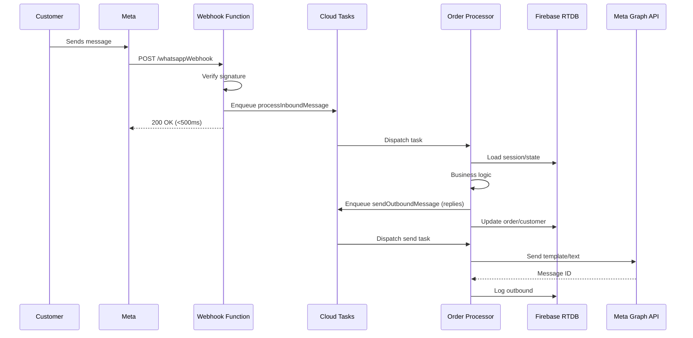
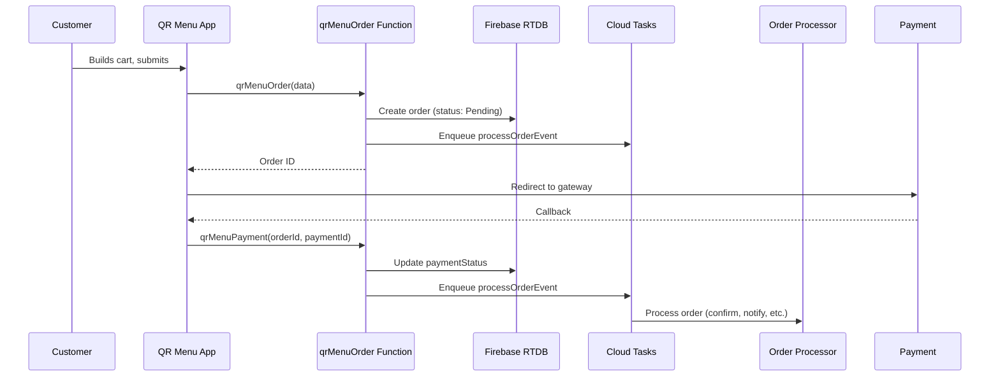

# Firebase Functions 2nd Gen - Architecture Design

## Overview

This document specifies the complete Firebase Functions 2nd Gen architecture for the Foodhubbie platform migration from EC2 to serverless.

---

## Function Inventory

### 1. HTTPS Functions (Public Endpoints)

| Function | Trigger | Purpose | Auth |
|----------|---------|---------|------|
| `whatsappWebhook` | `onRequest` | Receive Meta WhatsApp webhooks | Meta Signature |
| `paymentWebhook` | `onRequest` | Receive Razorpay/PhonePe callbacks | Gateway Signature |
| `qrMenuOrder` | `onCall` | Place order from QR Menu | Firebase Auth (anon) |
| `qrMenuPayment` | `onCall` | Verify payment from QR Menu | Firebase Auth (anon) |

### 2. Callable Functions (Admin/Internal)

| Function | Trigger | Purpose | Auth |
|----------|---------|---------|------|
| `botControl` | `onCall` | Restart, status, transport switch | Supreme Admin |
| `onboardingApprove` | `onCall` | Approve restaurant onboarding | Supreme Admin |
| `transportSwitch` | `onCall` | Switch Baileys/Meta transport | Supreme Admin |
| `passwordReset` | `onCall` | Reset admin password | Supreme Admin |
| `walletGatePublish` | `onCall` | Manual wallet gate recompute | Supreme Admin |
| `promoCampaignCreate` | `onCall` | Create promotional campaign | Outlet Admin |
| `promoCampaignSend` | `onCall` | Trigger campaign send | Outlet Admin |
| `generateReport` | `onCall` | Generate ad-hoc report | Outlet Admin |

### 3. Task Queue Functions (Async Processing)

| Function | Trigger | Purpose | Queue Config |
|----------|---------|---------|--------------|
| `processInboundMessage` | `onTaskDispatched` | Process WhatsApp inbound | Rate: 500/s, Concurrency: 80 |
| `sendOutboundMessage` | `onTaskDispatched` | Send WhatsApp outbound | Rate: 200/s, Concurrency: 50 |
| `processOrderEvent` | `onTaskDispatched` | Handle order lifecycle | Rate: 100/s, Concurrency: 20 |
| `runPromoCampaign` | `onTaskDispatched` | Execute promo batch send | Rate: 50/s, Concurrency: 10 |

### 4. Scheduled Functions (Cron)

| Function | Schedule | Purpose | Config |
|----------|----------|---------|--------|
| `walletGateCheck` | `every 1 minutes` | Recompute wallet gates (adaptive) | 256MB, 60s |
| `metaCostPublisher` | `every 5 minutes` | Update Meta credit balances | 256MB, 60s |
| `dailyReports` | `0 6 * * *` (6 AM IST) | Generate daily sales reports | 512MB, 300s |
| `weeklyReports` | `0 6 * * 1` (Monday 6 AM) | Generate weekly reports | 512MB, 600s |
| `monthlyReports` | `0 6 1 * *` (1st 6 AM) | Generate monthly reports | 512MB, 900s |
| `promoScheduler` | `every 15 minutes` | Check & queue due promos | 256MB, 120s |
| `notificationCapReset` | `0 0 * * *` (Midnight IST) | Reset daily notification caps | 128MB, 30s |

### 5. RTDB Triggers (Event-Driven)

| Function | Trigger Path | Purpose |
|----------|--------------|---------|
| `onOrderCreate` | `businesses/{bid}/outlets/{oid}/orders/{orderId}` | Initialize order processing |
| `onOrderStatusChange` | `businesses/{bid}/outlets/{oid}/orders/{orderId}/status` | Handle status transitions |
| `onOrderPaymentChange` | `businesses/{bid}/outlets/{oid}/orders/{orderId}/paymentStatus` | Payment verification |
| `onWalletUpdate` | `walletBilling/{bid}/{oid}/balance` | Recompute wallet gate |
| `onPromoCampaignCreate` | `businesses/{bid}/outlets/{oid}/bot/promotions/campaigns/{campaignId}` | Queue campaign |
| `onCustomerCreate` | `businesses/{bid}/outlets/{oid}/customers/{phone}` | Initialize loyalty |
| `onRiderAssign` | `businesses/{bid}/outlets/{oid}/riders/{riderId}/assignedOrders` | Notify rider |

### 6. Auth Triggers

| Function | Trigger | Purpose |
|----------|---------|---------|
| `onUserCreate` | `onCreate` | Sync custom claims, create admin mirror |
| `onUserDelete` | `onDelete` | Cleanup admin mirror, revoke tokens |

---

## Function Configuration Specs

### Webhook Receive (Critical Path)

```typescript
// functions/src/api/whatsappWebhook.ts
export const whatsappWebhook = onRequest({
  region: 'us-central1',
  memory: '256MiB',
  cpu: 0.167,
  timeoutSeconds: 30,
  minInstances: 5,           // CRITICAL: Warm for Meta 20s ack SLA
  maxInstances: 500,
  concurrency: 100,          // Per instance
  secrets: [
    'META_VERIFY_TOKEN',
    'META_SYSTEM_USER_TOKEN',
    'WA_PERMANENT_TOKEN'
  ],
  ingressSettings: 'ALLOW_ALL',
  labels: {
    'critical-path': 'true',
    'sla': '20s-ack'
  }
}, async (req, res) => {
  // 1. Verify Meta signature (X-Hub-Signature-256)
  // 2. Parse entry → changes → messages
  // 3. For each message: enqueue to processInboundMessage queue
  // 4. Return 200 OK immediately (< 500ms)
});
```

**SLA Requirements:**
- Respond 200 OK within **500ms** (Meta requires <20s, but we target <500ms)
- Process and enqueue within function timeout (30s)
- Zero message loss — use dead letter queue for failures

### Order Processor (Task Queue)

```typescript
// functions/src/taskqueue/processInboundMessage.ts
export const processInboundMessage = onTaskDispatched({
  region: 'us-central1',
  memory: '512MiB',
  cpu: 0.5,
  timeoutSeconds: 1800,      // 30 min max for complex flows
  minInstances: 0,
  maxInstances: 200,
  concurrency: 80,
  rateLimits: {
    maxDispatchesPerSecond: 500,
    maxConcurrentDispatches: 1000,
  },
  retryConfig: {
    maxAttempts: 3,
    minBackoffSeconds: 10,
    maxBackoffSeconds: 600,
    maxDoublings: 5,
  },
  secrets: [
    'WA_PERMANENT_TOKEN',
    'META_SYSTEM_USER_TOKEN',
    'FIREBASE_DATABASE_URL'
  ],
  labels: {
    'worker-type': 'order-processor'
  }
}, async (req) => {
  const { message, outlet, businessId } = req.data;
  
  // 1. Load outlet config, customer session
  // 2. Route to handler based on message type/state
  // 3. Execute business logic (menu, cart, order, payment, etc.)
  // 4. Send outbound replies via sendOutboundMessage queue
  // 5. Update RTDB order/customer state
});
```

**Queue Architecture:**

```
WhatsApp Webhook (HTTPS)
        │
        ▼
┌───────────────────┐
│  Validate & Parse │
│  (sync, <100ms)   │
└─────────┬─────────┘
          │
          ▼
┌───────────────────┐
│  Cloud Tasks      │
│  (processInbound) │
└─────────┬─────────┘
          │
    ┌─────┴─────┐
    ▼           ▼
Worker 1    Worker N
(80 conc)   (80 conc)
```

### Scheduled: Adaptive Wallet Gate

```typescript
// functions/src/scheduled/walletGateCheck.ts
export const walletGateCheck = onSchedule({
  schedule: 'every 1 minutes',
  region: 'us-central1',
  memory: '256MiB',
  timeoutSeconds: 60,
  secrets: ['FIREBASE_DATABASE_URL'],
}, async () => {
  // 1. Fetch all outlets with wallet.enforce === true (armed)
  // 2. For each armed outlet: recompute wallet from walletBilling + orders
  // 3. For disarmed outlets: check every 30 min (separate schedule or flag)
  // 4. Write walletGate to RTDB only if changed
  
  const armedOutlets = await getArmedOutlets(); // ~20% of outlets
  const disarmedCheck = (Date.now() / 1000 / 60) % 30 === 0;
  
  const outletsToCheck = disarmedCheck 
    ? allOutlets 
    : armedOutlets;
  
  await Promise.all(outletsToCheck.map(checkAndPublishWalletGate));
});
```

### Scheduled: Event-Driven Promo Runner

```typescript
// functions/src/scheduled/promoScheduler.ts
export const promoScheduler = onSchedule({
  schedule: 'every 15 minutes',
  region: 'us-central1',
  memory: '256MiB',
  timeoutSeconds: 120,
  secrets: ['FIREBASE_DATABASE_URL'],
}, async () => {
  // 1. Find campaigns where nextRunAt <= now AND status === 'running'
  // 2. For each campaign: enqueue runPromoCampaign task
  // 3. Update campaign.nextRunAt
  
  const dueCampaigns = await getDueCampaigns();
  await Promise.all(dueCampaigns.map(c => 
    enqueueTask('runPromoCampaign', { campaignId: c.id })
  ));
});
```

---

## Data Flow Diagrams

### WhatsApp Message Flow



### QR Menu Order Flow



---

## Shared Libraries Structure

```
functions/src/shared/
├── config/
│   ├── constants.ts          # All magic numbers, limits
│   ├── outlets.ts            # Outlet config loader
│   └── secrets.ts            # Secret accessor
├── firebase/
│   ├── admin.ts              # Admin SDK singleton
│   ├── rtdb.ts               # RTDB helpers (get, set, transaction)
│   └── paths.ts              # Path builders
├── whatsapp/
│   ├── metaApi.ts            # Graph API client
│   ├── templates.ts          # Template definitions
│   ├── messageBuilder.ts     # Message builders
│   └── webhookValidator.ts   # Signature verification
├── orders/
│   ├── pricing.ts            # Order pricing (port from shared/money-math)
│   ├── stateMachine.ts       # Order status transitions
│   └── validation.ts         # Order validation
├── loyalty/
│   ├── earn.ts               # Port from shared/loyalty-math
│   ├── redeem.ts             # Reward redemption
│   └── tiers.ts              # Tier definitions
├── wallet/
│   ├── compute.ts            # Port from shared/cost-math
│   ├── gate.ts               # Wallet gate logic
│   └── metaCost.ts           # Meta cost recording
├── notifications/
│   ├── fcm.ts                # FCM sender
│   ├── caps.ts               # Port from bot/notification-caps
│   └── templates.ts          # Push notification templates
├── utils/
│   ├── dates.ts              # IST helpers
│   ├── format.ts             # Order ID, phone, currency
│   ├── crypto.ts             # PIN hashing (port from Admin/js/pin-crypto)
│   └── validation.ts         # Input validation
└── types/
    ├── index.ts              # All TypeScript interfaces
    ├── webhook.ts            # Meta webhook payload types
    └── tasks.ts              # Task queue payload types
```

---

## Secrets Management

| Secret | Used By | Rotation |
|--------|---------|----------|
| `META_VERIFY_TOKEN` | Webhook | Annual |
| `META_SYSTEM_USER_TOKEN` | Meta API, Cost Pub | 60 days (Meta expiry) |
| `WA_PERMANENT_TOKEN` | Baileys (legacy), Meta sends | Per outlet |
| `FIREBASE_DATABASE_URL` | All functions | Never |
| `RAZORPAY_WEBHOOK_SECRET` | Payment webhook | Annual |
| `PHONEPE_WEBHOOK_SECRET` | Payment webhook | Annual |
| `SLACK_ALERT_WEBHOOK` | Alerting | As needed |
| `SENDGRID_API_KEY` | Email alerts | As needed |

---

## Deployment Configuration

### firebase.json

```json
{
  "functions": [
    {
      "source": "functions",
      "codebase": "default",
      "ignore": [
        "node_modules",
        ".git",
        "firebase-debug.log",
        "firebase-debug.*.log",
        "*.local.ts"
      ],
      "predeploy": [
        "npm --prefix functions run build",
        "npm --prefix functions run lint"
      ],
      "postdeploy": [
        "npm --prefix functions run deploy:verify"
      ]
    }
  ],
  "hosting": {
    "target": "admin",
    "public": "Admin/dist",
    "ignore": ["firebase.json", "**/.*", "**/node_modules/**"],
    "rewrites": [
      {
        "source": "**",
        "destination": "/index.html"
      }
    ],
    "headers": [
      {
        "source": "/version.json",
        "headers": [{"key": "Cache-Control", "value": "no-cache, no-store, must-revalidate"}]
      },
      {
        "source": "**/*.@(js|css|png|jpg|svg|woff2)",
        "headers": [{"key": "Cache-Control", "value": "public, max-age=31536000, immutable"}]
      }
    ]
  }
}
```

### .firebaserc

```json
{
  "projects": {
    "default": "foodhubbie-prod",
    "staging": "foodhubbie-staging"
  },
  "targets": {
    "foodhubbie-prod": {
      "hosting": {
        "admin": ["admin"],
        "supreme": ["supreme"],
        "menu": ["menu"],
        "rider": ["rider"],
        "website": ["website"]
      }
    }
  }
}
```

---

## Environment-Specific Config

### Staging (foodhubbie-staging)

```bash
# functions/.env.staging
NODE_ENV=staging
LOG_LEVEL=debug
META_VERIFY_TOKEN=staging_verify_token
META_SYSTEM_USER_TOKEN=staging_system_token
FIREBASE_DATABASE_URL=https://foodhubbie-staging-default-rtdb.firebaseio.com
```

### Production (foodhubbie-prod)

```bash
# functions/.env.production
NODE_ENV=production
LOG_LEVEL=info
META_VERIFY_TOKEN=prod_verify_token
META_SYSTEM_USER_TOKEN=prod_system_token
FIREBASE_DATABASE_URL=https://foodhubbie-10-default-rtdb.firebaseio.com
```

---

## Monitoring & Observability

### Structured Logging

```typescript
// functions/src/shared/utils/logger.ts
import { logger } from 'firebase-functions/v2';

export function createLogger(context: string) {
  return {
    info: (message: string, meta?: object) => 
      logger.info(`[${context}] ${message}`, meta),
    warn: (message: string, meta?: object) => 
      logger.warn(`[${context}] ${message}`, meta),
    error: (message: string, error?: Error, meta?: object) => 
      logger.error(`[${context}] ${message}`, { error: error?.stack, ...meta }),
    debug: (message: string, meta?: object) => 
      logger.log(`[${context}] ${message}`, meta),
  };
}
```

### Custom Metrics (Cloud Monitoring)

```typescript
// functions/src/shared/utils/metrics.ts
import { Monitoring } from '@google-cloud/monitoring';

const monitoring = new Monitoring.MetricServiceClient();
const projectPath = monitoring.projectPath(process.env.GCP_PROJECT!);

export async function recordMetric(
  type: string,
  value: number,
  labels: Record<string, string> = {}
) {
  const request = {
    name: projectPath,
    timeSeries: [{
      metric: {
        type: `custom.googleapis.com/foodhubbie/${type}`,
        labels: { ...labels, environment: process.env.NODE_ENV! }
      },
      points: [{
        interval: { endTime: { seconds: Date.now() / 1000 } },
        value: { doubleValue: value }
      }]
    }]
  };
  await monitoring.createTimeSeries(request);
}

// Usage
await recordMetric('webhook_latency_ms', latency, { outlet: 'pizza' });
await recordMetric('order_processing_duration_ms', duration, { type: 'whatsapp' });
await recordMetric('meta_api_errors_total', 1, { endpoint: 'sendTemplate' });
```

---

## Error Handling & Dead Letter Queues

### Task Queue Error Handling

```typescript
// functions/src/taskqueue/baseWorker.ts
export async function withErrorHandling<T>(
  task: Task<T>,
  handler: (data: T) => Promise<void>
) {
  const maxRetries = 3;
  let attempt = 0;
  
  while (attempt < maxRetries) {
    try {
      await handler(task.data);
      return; // Success
    } catch (error) {
      attempt++;
      if (attempt >= maxRetries) {
        // Send to DLQ
        await sendToDeadLetterQueue(task, error);
        throw error; // Mark task as failed
      }
      // Exponential backoff
      await sleep(Math.min(1000 * 2 ** attempt, 30000));
    }
  }
}

async function sendToDeadLetterQueue(task: Task, error: Error) {
  await admin.database().ref('deadLetterQueue').push({
    originalQueue: task.queueName,
    payload: task.data,
    error: error.message,
    stack: error.stack,
    attempts: task.attempts,
    timestamp: Date.now()
  });
  
  // Alert on-call
  await sendSlackAlert(`🚨 DLQ: ${task.queueName} - ${error.message}`);
}
```

---

## Security Considerations

### Webhook Signature Verification

```typescript
// functions/src/shared/whatsapp/webhookValidator.ts
import crypto from 'crypto';

export function verifyMetaSignature(
  payload: string | Buffer,
  signature: string,
  appSecret: string
): boolean {
  const expected = 'sha256=' + crypto
    .createHmac('sha256', appSecret)
    .update(payload)
    .digest('hex');
  
  // Timing-safe comparison
  return crypto.timingSafeEqual(
    Buffer.from(signature),
    Buffer.from(expected)
  );
}
```

### Rate Limiting (Per Outlet)

```typescript
// functions/src/shared/utils/rateLimiter.ts
export async function checkRateLimit(
  outlet: string,
  action: string,
  limit: number,
  windowMs: number
): Promise<boolean> {
  const key = `ratelimit:${outlet}:${action}`;
  const now = Date.now();
  const windowStart = now - windowMs;
  
  const snap = await admin.database().ref(key).once('value');
  const requests = Object.values(snap.val() || {})
    .filter((ts: number) => ts > windowStart);
  
  if (requests.length >= limit) {
    return false;
  }
  
  requests.push(now);
  await admin.database().ref(key).set(
    Object.fromEntries(requests.map((ts, i) => [i, ts]))
  );
  return true;
}
```

---

## Testing Strategy

### Unit Tests (Jest)

```bash
# functions/package.json
{
  "scripts": {
    "test": "jest --coverage",
    "test:watch": "jest --watch",
    "test:ci": "jest --ci --coverage --maxWorkers=2"
  }
}
```

### Integration Tests (Firebase Emulator)

```bash
# functions/test/integration.test.ts
import { test, expect, beforeAll, afterAll } from '@jest/globals';
import { initFunctionsEmulator, cleanupFunctionsEmulator } from './emulator';

beforeAll(async () => {
  await initFunctionsEmulator();
});

afterAll(async () => {
  await cleanupFunctionsEmulator();
});

test('whatsappWebhook processes message', async () => {
  const response = await fetch('http://localhost:5001/foodhubbie-staging/us-central1/whatsappWebhook', {
    method: 'POST',
    headers: { 'Content-Type': 'application/json', 'X-Hub-Signature-256': 'sha256=...' },
    body: JSON.stringify({ object: 'whatsapp_business_account', entry: [...] })
  });
  expect(response.status).toBe(200);
});
```

### Load Testing (k6)

```javascript
// functions/test/load.js
import http from 'k6/http';
import { check, sleep } from 'k6';

export const options = {
  stages: [
    { duration: '2m', target: 100 },   // Ramp up
    { duration: '5m', target: 500 },   // Peak
    { duration: '2m', target: 1000 },  // Stress
    { duration: '5m', target: 0 },     // Ramp down
  ],
  thresholds: {
    http_req_duration: ['p(95)<500'],
    http_req_failed: ['rate<0.01'],
  },
};

export default function() {
  const payload = JSON.stringify({ /* webhook payload */ });
  const params = { headers: { 'Content-Type': 'application/json' } };
  const res = http.post('https://us-central1-foodhubbie-prod.cloudfunctions.net/whatsappWebhook', payload, params);
  check(res, { 'status 200': (r) => r.status === 200 });
  sleep(1);
}
```

---

## Rollout Plan

### Phase 1: Webhook + Order Processor (Week 1-2)
- Deploy webhook function with minInstances=5
- Deploy order processor task queue
- Mirror traffic: 10% to Functions, 90% to EC2
- Validate message processing parity

### Phase 2: Scheduled Functions (Week 3)
- Deploy wallet gate (adaptive)
- Deploy meta cost publisher
- Deploy reports
- Compare outputs with EC2

### Phase 3: Admin API + Triggers (Week 4)
- Deploy callable functions
- Deploy RTDB triggers
- Migrate admin dashboard to call Functions

### Phase 4: Cutover (Week 5)
- 100% traffic to Functions
- Decommission EC2 API processes
- Monitor for 48 hours
- Full decommission

### Rollback Plan
- Keep EC2 running for 2 weeks post-cutover
- DNS/Cloudflare can route back in <5 min
- Feature flags in Admin to switch API endpoints